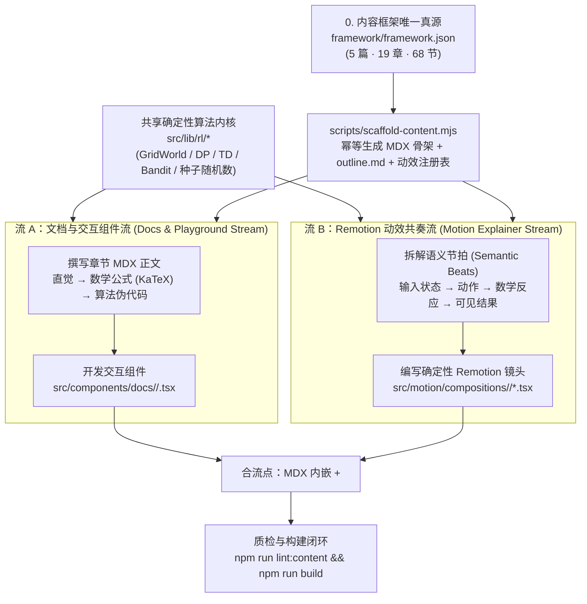

# Hello-Reinforcement-Learning 双流共奏工作流 (Dual-Stream Workflow)

> **核心理念**：先把整套强化学习内容框架 (`framework/framework.json`) 设计完整，再通过**文档流 (Docs Stream)** 与 **动效流 (Remotion Motion Stream)** 两条并行共奏的工作流逐步落地每一章的正文、交互实验室与逐帧动作讲解。



---

## 一、四阶段标准作业程序 (SOP)

### Phase 1：框架先行（Framework First）

1. 所有章节、小节、核心知识点 (`points`)、规划的交互组件 (`components`)、规划的动作讲解镜头 (`motions`) 统一声明在 [`framework/framework.json`](./framework/framework.json)。
2. 运行脚手架：
   ```bash
   node scripts/scaffold-content.mjs
   ```
   自动同步生成：
   - `outline.md`（全景大纲视图）
   - `content/docs/**/meta.json` 与未完成小节的骨架 `.mdx`（幂等，绝不覆盖已脱掉 `@status: skeleton` 的正文）
   - `src/motion/compositions/index.ts`（动效总注册表）

### Phase 2：共享算法内核（Deterministic RL Kernel）

- 位于 [`src/lib/rl/`](./src/lib/rl/)。
- 所有算法必须使用 `createRng(seed)`（禁止 `Math.random()`），并返回完整过程快照（`snapshots` / `trace`），以便：
  - **交互组件**能拖动参数滑块实时重算；
  - **Remotion 动效**能根据 `useCurrentFrame()` 确定性索引任意时刻的状态。

### Phase 3：双流并行生产（Docs Stream ∥ Motion Stream）

| 维度 | 流 A：文档与交互组件流 | 流 B：Remotion 动作讲解流 |
| --- | --- | --- |
| **专属 Skill** | `.agents/skills/rl-docs-author/SKILL.md` | `.agents/skills/rl-motion-director/SKILL.md` |
| **核心职责** | 讲清“为什么”（数学推导）与“调参会发生什么”（交互实验） | 讲清“一步更新/一次备份在时间上是如何发生的”（连续空间动画） |
| **产物目录** | `content/docs/<chapter>/*.mdx`<br>`src/components/docs/<chapter>/*.tsx` | `src/motion/compositions/<chapter>/*.tsx`<br>`src/motion/compositions/<chapter>/index.ts` |
| **硬性规范** | 首行 `'use client'`、亮暗主题自适应、使用 Fumadocs `Callout`/`Cards` | 遵守 [`src/motion/HARD_RULES.md`](./src/motion/HARD_RULES.md)：纯 `frame` 驱动、`interpolate` 必带 `clamp` |
| **独立预览** | `npm run dev` → `/docs/<chapter>` 或 `/app` | `npm run dev` → `/motion` 或 `npm run motion:studio` |

### Phase 4：合流质检与提交（Verification & Commit）

每完成一个小节或一个镜头，执行：

```bash
npm run lint:content   # 检查框架对齐、组件存在性、动效注册、确定性红线
npm run types:check    # MDX 类型生成 + TypeScript 严格检查
```

通过后立即按语义提交 Git（`feat(docs): ...` / `feat(motion): ...`）。
